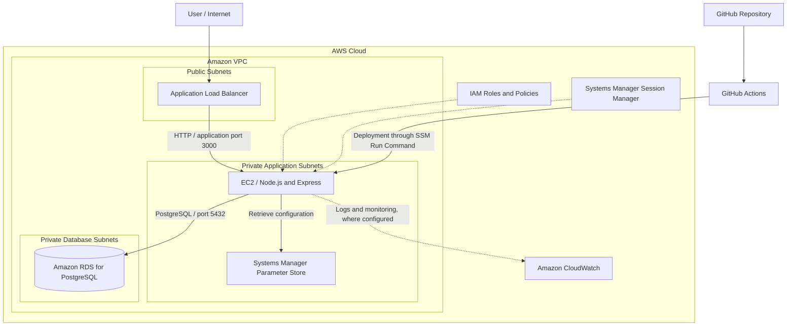

# Spider-Man Mission Control

A learning project demonstrating how to deploy, operate, monitor, and troubleshoot a Node.js mission-management application on AWS using infrastructure services and an automated GitHub Actions delivery workflow.

## Table of Contents

- [Overview](#overview)
- [Architecture](#architecture)
- [AWS Services and Design Decisions](#aws-services-and-design-decisions)
- [Technology Stack](#technology-stack)
- [Deployment Workflow](#deployment-workflow)
- [Application Endpoints](#application-endpoints)
- [Testing and Operational Evidence](#testing-and-operational-evidence)
- [Security Considerations](#security-considerations)
- [Limitations and Future Improvements](#limitations-and-future-improvements)
- [What I Learned](#what-i-learned)
- [Project Links](#project-links)

## Overview

Spider-Man Mission Control is a simple mission/task-list application built to explore the operational responsibilities involved in running a cloud-hosted application.

The project brings together networking, compute, database connectivity, secure configuration, deployment automation, health checks, service recovery, and failure testing.

The goal is to demonstrate not only how to deploy an application, but also how to investigate problems and verify how the system behaves when components fail.

## Architecture

### Request flow

**Internet → Application Load Balancer → EC2 (Node.js/Express) → Amazon RDS for PostgreSQL**

### Architecture diagram

*The diagram represents the intended logical architecture. Validate subnet placement, monitoring configuration, and the exact deployment path against the resources currently running in AWS.*

### How it works

1. **Internet → ALB:** An internet-facing Application Load Balancer receives HTTP requests on port 80.
2. **ALB → EC2:** The load balancer forwards requests to the Node.js/Express application listening on port 3000.
3. **EC2 → RDS:** The application connects to the PostgreSQL database over port 5432.
4. **EC2 → Parameter Store:** The application retrieves database configuration from AWS Systems Manager Parameter Store using its assigned IAM permissions.
5. **GitHub Actions → EC2:** The CI/CD workflow invokes AWS Systems Manager Run Command to run deployment commands remotely.
6. **Operations and recovery:** Application endpoints, service status, logs, and ALB target health provide evidence for troubleshooting and failure testing.

## AWS Services and Design Decisions

| Service | Purpose |
|---|---|
| Amazon VPC | Provides an isolated network for the application infrastructure. |
| Public and private subnets | Separate the public entry point from application and database resources. |
| Application Load Balancer | Routes incoming HTTP requests to registered application targets. |
| Amazon EC2 | Runs the Node.js/Express application. |
| Amazon RDS for PostgreSQL | Provides managed relational database storage. |
| AWS IAM | Controls permissions for AWS resources and automation. |
| Systems Manager Parameter Store | Stores application configuration and database credentials separately from source code. |
| Systems Manager Run Command | Executes remote deployment and operational commands without requiring SSH access. |
| Systems Manager Session Manager | Provides interactive instance access without opening inbound SSH port 22. |
| Amazon CloudWatch | Supports monitoring and log analysis when the relevant metrics and log collection are configured. |
| GitHub Actions | Automates validation, testing, deployment, and post-deployment checks. |

## Technology Stack

- **Cloud infrastructure:** AWS VPC, EC2, Application Load Balancer, RDS PostgreSQL, IAM, Systems Manager, CloudWatch
- **Application:** Node.js, Express, PostgreSQL, HTML, CSS
- **Automation:** GitHub Actions, npm tests, AWS CLI, Systems Manager Run Command
- **Operational checks:** HTTP health endpoints, service status, application logs, ALB target health, failure-injection tests

## Deployment Workflow

The GitHub Actions workflow automates the application delivery process.

1. **Validate:** Check the required project files and workflow prerequisites.
2. **Install dependencies:** Install the Node.js dependencies required by the application and tests.
3. **Run tests:** Execute the configured automated tests.
4. **Deploy remotely:** Use AWS Systems Manager Run Command to execute deployment commands on the EC2 instance.
5. **Verify readiness:** Check the deployed application's readiness using the configured health or readiness endpoint.

### Infrastructure and deployment considerations

- The ALB acts as the public entry point and forwards traffic to the application on port 3000.
- The EC2 security group should allow application traffic only from the ALB security group.
- RDS should remain in private subnets with public access disabled.
- Database inbound traffic should be restricted to the application security group on port 5432.
- Application configuration and credentials should be retrieved from Parameter Store rather than hard-coded into the source code.
- Systems Manager Session Manager provides interactive access without requiring an inbound SSH rule.

## Application Endpoints

| Endpoint | Purpose |
|---|---|
| `/health` | Reports basic application health. |
| `/ready` | Checks whether the application is ready to serve requests, including database connectivity where implemented. |
| `/api/missions` | Returns mission data from the application API. |

A successful `/health` response does not necessarily mean the database is available. The readiness endpoint should check the dependencies required for the application to operate correctly.

## Testing and Operational Evidence

The following evidence documents application behaviour, infrastructure recovery, and troubleshooting exercises. Expand each section to view the related screenshots.

### 1. Application health

Verifies that the application responds to a health-check request.

### 2. Database readiness

Demonstrates the readiness endpoint and its database-dependency check.

### 3. Mission API

Demonstrates the mission-data API response.

### 4. ALB target health during an application failure

These screenshots document the load balancer's target-health behaviour when the application service is stopped.

<strong>View ALB target health and recovery evidence</strong>

### 5. Database connection failure

A controlled test temporarily uses an incorrect database password to investigate how the application responds when database authentication fails.

<strong>View database failure and troubleshooting evidence</strong>

**Test safety:** Restore the correct parameter immediately after testing and verify that the application can connect to the database again. Avoid leaving invalid credentials in a shared or active environment.

### 6. Auto Scaling Group instance replacement

These screenshots document instance replacement after an EC2 instance is terminated. This demonstrates recovery through the Auto Scaling Group's desired-capacity configuration; it does not demonstrate scaling in response to increased demand.

<strong>View instance replacement evidence</strong>

### 7. Application service status and logs

These screenshots provide operational evidence for investigating the application service and its logs.

<strong>View service status and log evidence</strong>

## Security Considerations

The project applies several security principles:

- **Network segmentation:** Separate public entry points from private application and database resources.
- **Least privilege:** Restrict security-group rules and IAM permissions to the resources and actions that need them.
- **Private database:** Disable public access to RDS and allow database connections only from the application security group.
- **Secrets management:** Store database credentials in Parameter Store as `SecureString` parameters, with appropriate IAM access controls and encryption permissions.
- **Secure administration:** Use Systems Manager Session Manager instead of exposing SSH to the internet.
- **CI/CD credentials:** Avoid committing AWS access keys, database passwords, or other secrets to the repository.

The current workflow uses long-lived AWS access keys stored in GitHub Actions secrets. Migrating to GitHub Actions OpenID Connect (OIDC) with a narrowly scoped IAM role would reduce the need for long-lived credentials.

## Limitations and Future Improvements

### High-priority improvements

- **Enable HTTPS:** Configure an HTTPS listener using an AWS Certificate Manager certificate and redirect HTTP traffic to HTTPS.
- **Adopt GitHub Actions OIDC:** Replace long-lived AWS access keys with short-lived role credentials.
- **Verify configuration consistency:** Confirm that `server.js`, `test.js`, and the actual Parameter Store paths and parameter names agree.
- **Improve deployment validation:** Add an HTTP smoke test after deployment and verify that the expected application version is running.
- **Strengthen observability:** Configure and validate application logs, relevant CloudWatch metrics, and alarms for application and infrastructure failures.

### Availability and scaling improvements

- **Database resilience:** The documented RDS design is Single-AZ. Multi-AZ deployment and failover are not configured in this design.
- **Horizontal scaling:** An Auto Scaling Group with minimum, desired, and maximum capacity set to `1` demonstrates instance replacement, not load-based horizontal scaling. A future improvement would introduce appropriate capacity settings and scaling policies.
- **Production readiness:** Add HTTPS, stronger deployment safeguards, and documented recovery procedures before describing the application as production-ready.

### Cost considerations

AWS resources can incur charges even when the application receives little or no traffic. Review the cost of the ALB, EC2, RDS, storage, monitoring, and data transfer. Stop or remove resources when they are no longer needed, while preserving any evidence required for the project.

## What I Learned

This project strengthened my practical understanding of AWS network segmentation, security-group design, managed database connectivity, and secure application configuration.

I gained hands-on experience with automated deployment through GitHub Actions and Systems Manager Run Command, and learned to distinguish application health from dependency readiness.

The failure-testing exercises also helped me investigate database connection problems, analyse service logs, interpret load balancer target health, and understand the difference between instance replacement and demand-based scaling.

Most importantly, the project reinforced that operating a cloud application involves more than getting it deployed: it also requires validating its behaviour, controlling access, monitoring dependencies, and planning for recovery.

## Project Links

- [Source code and README](https://github.com/imed3721/spiderman-mission-control)
- [GitHub Actions workflows and run history](https://github.com/imed3721/spiderman-mission-control/actions)
